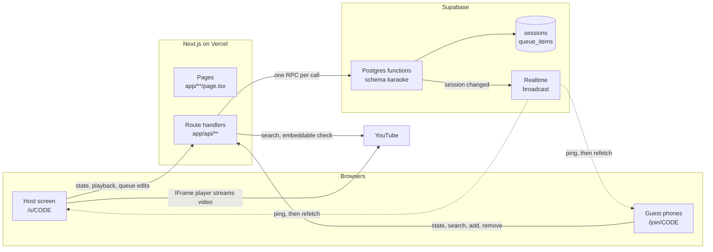

# Architecture

How YouOke is put together, and where things go. The reasons behind each choice are
in the decision records under [`adr/`](adr/README.md); this page links to them
rather than repeating them. If you change something here, check its record first:
each one says what it was protecting and when it should be reconsidered.

## The app in one paragraph

One browser (the **host**, usually a TV or laptop) starts a **session** and plays
YouTube karaoke videos. Everyone else (**guests**, on phones) opens the session by
its 6-character **code** and adds songs to a shared **queue**. Postgres holds the
sessions and queues and enforces every rule; the Next.js server is a thin layer
between browsers and the database; browsers refetch the session whenever they are
told it changed.

## Parts



| Part | Does | Does not |
| --- | --- | --- |
| Postgres functions (`supabase/migrations`) | Every rule: who may do what, queue order, what plays next, archiving | Know about HTTP or YouTube search |
| Route handlers (`app/api`) | Read cookies, validate input shape, rate-limit, call one database function, map its answer to HTTP | Decide permissions or queue order |
| Pages (`app/**/page.tsx`) | Validate the code in the URL, send phones to the guest view, render a screen component | Hold state |
| Screen components (`components`) | Draw the session state, call the API | Talk to the database; hold the truth about the session |
| YouTube | Search results (server), the video stream (host's browser) | Store anything of ours |

Records: [0001 Next.js monolith](adr/0001-nextjs-monolith.md),
[0002 rules in the database](adr/0002-database-functions-are-the-only-data-access.md),
[0003 ping and refetch](adr/0003-realtime-ping-then-refetch.md).

## Code layout

```
app/                    Routes only: pages and API route handlers
  api/search            GET   search YouTube (needs a live session code)
  api/csp-report        POST  browsers report what the Content-Security-Policy would block
  api/sessions          POST  start a session
  api/sessions/[code]   GET   session state, PATCH settings (host), DELETE end it (host)
    playback            POST  play | pause | next        (host)
    queue               POST  add a song
    queue/[id]          DELETE remove, PATCH move        (PATCH: host)
  s/[code]              Host screen
  join/[code]           Guest screen
components/             React components shared by both screens
  host/                 Only on the host screen
  guest/                Only on the guest screen
lib/
  domain/               Pure TypeScript: types, formatting, queue maths, key mapping
  server/               Runs only on the server: cookies, database, YouTube search, API plumbing
  client/               Runs only in the browser: hooks, API calls, localStorage, Realtime
supabase/
  migrations/           The schema and every database function
  tests/                SQL tests for those functions
scripts/                migrate.mts (applies migrations on a production build) and test-db.sh
tests/                  Unit tests, mirroring lib/ (plus tests/api for the route handlers)
e2e/                    Browser tests for the screens, with the session API faked
docs/                   This page, conventions, decision records
```

### Layer rules

Imports point inward only. ESLint enforces this (`eslint.config.mjs`), so a
violation fails `npm run lint`.

```
app, components  ──▶  lib/client  ──▶  lib/domain
app/api, pages   ──▶  lib/server  ──▶  lib/domain
```

- `lib/domain` imports nothing from the app, React, Next, Node or Supabase. That is
  what lets all of it be tested without mocks.
- `lib/client` and `components` never import `lib/server`. Browser code reaches the
  server only through `lib/client/session-api.ts`.
- `lib/server` never imports `lib/client`, components or React.

Record: [0011 layered lib](adr/0011-layered-lib.md).

### Where does new code go?

| You are adding | Put it in |
| --- | --- |
| A rule about who may do something, or how the queue behaves | A new migration in `supabase/migrations`, with a test in `supabase/tests` |
| A calculation or wording both screens need | `lib/domain`, test first |
| A new API call | Route handler in `app/api`, body parser in `lib/server/request-parsers.ts`, database call in `lib/server/session-store.ts`, browser call in `lib/client/session-api.ts` |
| Anything that touches YouTube search | `lib/server/youtube-search.ts` only |
| A piece of one screen | `components/host` or `components/guest` |
| A value kept in the browser | A key in `STORAGE_KEYS` (`lib/client/browser-hooks.ts`) |

## Data

Two tables in the `karaoke` schema:

- `sessions`: `code`, `host_token_hash`, `current_item_id`, `is_playing`,
  `last_active_at`, `host_seen_at` (last poll from the main screen), `archived_at`.
- `queue_items`: one row per added song with `status` `queued` → `playing` → `played`
  (with `played_at` set when it finishes),
  a floating-point `position` for ordering, the singer's name, the adder's guest id, and
  `singer`, who takes turns (`guest:<id>`, or `name:<name>` for songs the main screen adds).
  With 3 or more singers, `add_item` places each new song by turns (ADR 0016), unless the
  session's `take_turns` is off; `move_item` can still put a song anywhere.

Neither table can be read or written directly: row level security is on with no
policies. The eight public functions are the whole API of the database:

| Function | Called by | Answers |
| --- | --- | --- |
| `create_session(code, host_hash)` | `POST /api/sessions` | `true`, or `false` if the code is taken |
| `get_state(code, host_hash, guest_id)` | `GET /api/sessions/[code]`, search, start page | The `SessionState` JSON (current song, queue, and the last 50 sung), or null |
| `add_item(...)` | `POST .../queue` | a result code |
| `remove_item(code, item_id, host_hash, guest_id)` | `DELETE .../queue/[id]` | a result code |
| `move_item(code, host_hash, item_id, after_id, guest_id)` | `PATCH .../queue/[id]` | a result code |
| `playback(code, host_hash, action, expected_item_id, guest_id)` | `POST .../playback` | a result code |
| `set_take_turns(code, host_hash, on)` | `PATCH /api/sessions/[code]` | a result code |
| `end_session(code, host_hash)` | `DELETE /api/sessions/[code]` | a result code |

Result codes are `ok`, `stale`, `not_found`, `forbidden`, `invalid`, `queue_full`, `guest_limit`,
`archived` (`MutationResult` in `lib/domain/types.ts`). `lib/server/api.ts` maps
each to an HTTP status and the body `{ ok, result }` or `{ ok: false, error }`.

Session lifecycle: [0008](adr/0008-archive-on-access.md).

## Who is who

There are no accounts ([0004](adr/0004-anonymous-cookie-identity.md)).

- **Host**: the browser that started the session holds a random token in an httpOnly
  cookie `kh_<CODE>`. The database stores only its SHA-256 hash and compares hashes.
- **Guest**: every browser gets a random id in the httpOnly cookie `kg`. It marks
  which queued songs are "mine" and may be removed by that browser.
- **Singer name**: typed on the phone, kept in localStorage, sent with each add. It
  is a label, not an identity.
- **Room**: a guest's browser is in one room at a time, kept in localStorage next to the
  name, so all its tabs share both. A tab on another room's link asks before switching;
  the start page sends the browser back to its room ([0017](adr/0017-one-room-per-browser.md)).

Phones are always guests: the server sends a phone that opens a host URL to the
guest view ([0007](adr/0007-phones-are-guests.md)). The exception is the **remote**:
the first guest whose phone loads the session may play, pause, skip, remove and reorder
like the main screen, from the guest view. Ending the session stays with the main
screen. It is stored as `sessions.remote_guest_id` ([0014](adr/0014-first-guest-is-the-remote.md)).
Any guest may also skip their own song while it is being sung.

## How a change reaches every screen

1. A browser calls the API (say, add a song).
2. The route handler calls the database function, which changes the rows and
   broadcasts `changed` on the Realtime channel `session:<CODE>`.
3. Every screen subscribed to that channel refetches `GET /api/sessions/<CODE>`.
4. Screens also refetch on focus and every 15 seconds, so a missed ping heals itself.

The host screen is the one exception to "server is the truth": for play and pause
it trusts its own player first and tells the server after, because the video is
playing in that browser.

## Playback

Only the host screen plays video, through YouTube's IFrame player with YouTube's
controls turned off and the app's own TV-sized controls in their place
([0005](adr/0005-youtube-iframe-player.md)). The screen is drawn on a 1920 × 1080
grid that scales with the window ([0009](adr/0009-tv-scale-grid.md)). Search runs on
the server without an API key ([0006](adr/0006-keyless-youtube-search.md)).

## Limits and their homes

| Limit | Value | Enforced in |
| --- | --- | --- |
| Session code | 6 chars, no 0/O/1/I/L | `lib/domain/session-code.ts` |
| Waiting songs per session | 200 | `add_item` |
| Waiting songs per guest | 3, only once 3 or more people have songs on the list; never for the main screen | `add_item`; mirrored in `lib/domain/singers.ts` |
| Singer name | 40 chars | `add_item`; mirrored in `lib/domain/singers.ts` |
| Search query | 120 chars | `lib/domain/video.ts` |
| Inactivity before archive | 15 min | `idle_limit()` (used by `check_archived`, `cleanup`, `get_state`) |
| Archive kept for | 24 h | `cleanup` |
| Requests per minute | search 40/IP, start 10/IP, add 30/guest | `lib/server/rate-limit.ts` ([0010](adr/0010-in-memory-limits-and-caches.md)) |

## Testing

See [0012](adr/0012-testing-strategy.md) and [CONVENTIONS.md](CONVENTIONS.md#tests).

| Layer | Tested by | Command |
| --- | --- | --- |
| `lib/domain`, `lib/server`, `lib/client/session-api` | Vitest unit tests | `npm test` |
| Route handlers | Vitest, with the database and cookies faked (`tests/api`) | `npm test` |
| Database functions | SQL assertions against a real Postgres (`supabase/tests`) | `npm run test:db` |
| Screens and whole flows | Playwright against a production build, with the session API answered by fixtures (`e2e`) | `npm run test:e2e` |
| The app against a real Supabase project and real YouTube | Not automated | by hand, on a preview deploy |
